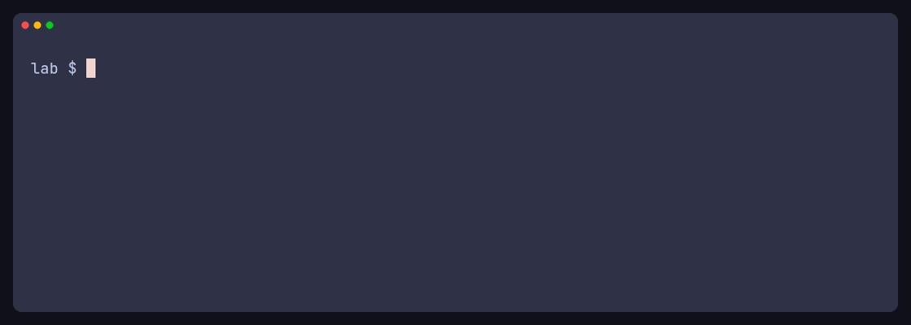

# Length-prefixed INSERT injection

A small local lab. A service checks that a record's length header matches its body, then builds an `INSERT` by concatenating that body into a SQL string. When the statement fails, the HTTP response includes the PostgreSQL error. That combination is enough to read a value from another table.

The record format, the names and the canary are invented for this lab. The client refuses any host other than localhost. Compose publishes the application only on `127.0.0.1:18080`. The database port stays on the Compose network. `lab` and `app` are the passwords of that local database.

## Demo

One recording, three requests. The first two run in the default mode. The tape then restarts the same service with `LAB_MODE=safe` and repeats the payload.



`vhs demos/demo.tape` renders it again. The typed command is `demos/show.py`. The laboratory has to be listening on `127.0.0.1:18080` before the tape starts.

## What is wrong

`POST /notes` expects:

```text
v1|<4 hex digits>|<body>
```

The four digits are the byte length of the body. `v1|0003|abc` is accepted. `v1|00FF|nope` is rejected with `400` and never reaches the database. A scanner that sends a quote by itself fails that check, so the injection looks closed.

After the check, vulnerable mode runs:

```sql
INSERT INTO notes (body) VALUES ('<body>')
```

The proof sends a body that closes the opened quote and forces a cast:

```sql
'||CAST((SELECT value FROM secrets LIMIT 1) AS integer)||'
```

PostgreSQL then answers `invalid input syntax for type integer` and puts the selected text in that message. The handler returns `message_primary` to the client. The database role used by the app is not a superuser. It can insert into `notes` and select from `secrets`.

There is a second, related limit. Automated tools often spell a short string as `CHR(n)||CHR(n)`. Under a tight length budget that chain no longer fits, even when the same text as a quoted literal does. `poc/wrap.py` folds those chains back into a literal before it writes the length header.

## Run

From this directory, with Docker:

```bash
./scripts/prove.sh
```

The script builds the lab on `127.0.0.1:18080`, runs the unit tests, checks vulnerable mode, restarts the app in safe mode, checks that again, and removes the containers.

Useful pieces, if you want to run them apart:

```bash
docker compose up --build --wait
python3 -m unittest tests/test_wrap.py
python3 poc/prove.py
LAB_MODE=safe docker compose up -d --force-recreate --no-deps --wait app
python3 poc/prove.py --expect-safe
docker compose down -v
```

Vulnerable mode prints `database error contains lab-canary-7f3a`. That value is inserted by `app/schema.sql`. Safe mode prints that the same record was stored as ordinary text.

## The fix

Safe mode is the same process with `LAB_MODE=safe`:

- the body is bound with `%s`, so a quote is data;
- a database failure returns `STORE_FAILED` and omits the driver message.

A length check is still useful, and it does not replace either of those two changes. The gate only rejects records whose header does not match. An attacker who can write the header still reaches the query.

## Detection

On an exposed service, the signal is a valid record of this shape followed by HTTP 500 and a body that contains `invalid input syntax` or another PostgreSQL primary message. The rejected records with a bad length are noise. They show that the parser ran, not that the query is parameterized.

## Layout

| Path | Role |
| --- | --- |
| `app/server.py` | The vulnerable handler and the safe one |
| `app/schema.sql` | Notes, the demo secret, and the restricted role |
| `poc/wrap.py` | Length header and `CHR()` folding |
| `poc/prove.py` | Local checks for the leak and for the fix |
| `demos/demo.tape` | The GIF in the section above |
| `tests/test_wrap.py` | Header, byte length, and the length budget |
